# Modelo de datos relacional (Turso) — Multi-Empresa

Modelo relacional de base de datos en **Turso (libSQL/SQLite)** para soportar la migración definitiva desde Google Sheets hacia un esquema relacional con integridad referencial, transacciones ACID y soporte nativo para **múltiples empresas independientes**.

---

## 1. Principios arquitectónicos

1. **Identidad global (`user`) y membresías por empresa (`empresa_miembro`)**:
   - `user` es gestionada por Better-Auth como credencial única de login (email, OAuth, sesiones).
   - Una persona física puede prestar servicios en múltiples empresas independientes mediante `empresa_miembro`. En cada empresa cuenta con un puesto laboral, departamento base, jefe directo (`manager_id`), rol de permisos y tarifas independientes.
2. **Empresas iniciales**:
   - El sistema arranca con dos empresas semilla: `vortex-it` (Vortex IT) y `bit-technologies` (Bit Technologies).
3. **Departamentos y Equipos de trabajo (Squads)**:
   - Cada empresa define sus propios `departamento` (áreas funcionales como Ingeniería, Producto, Diseño) y `equipo_trabajo` (squads o unidades de entrega como Squad Core, Squad Mobile).
   - Los equipos pertenecen a la empresa y opcionalmente a un departamento.
   - La relación entre miembros y equipos es N:M a través de `equipo_miembro`.
4. **Colaboración Cross-Empresa en Proyectos**:
   - Un proyecto pertenece a una empresa titular (`empresa_id`) y a un cliente (`cliente_id`).
   - Distintos equipos de varias empresas pueden colaborar en un mismo proyecto mediante `proyecto_equipo`.
   - La asignación granular de colaboradores se realiza en `proyecto_miembro`, permitiendo computar costos según las tarifas vigentes de la empresa de procedencia del colaborador.
5. **Transición incremental de Google Sheets**:
   - Las lecturas operativas de Google Sheets (incluyendo la hoja `Repositorios` y tablas operativas) se mantienen activas durante la fase de convivencia hasta que todas las entidades y repositorios estén migrados y validados en Turso.

---

## 2. Diagrama Entidad-Relación (Mermaid)

```mermaid
erDiagram
    %% Identidad global y membresias
    USER ||--o{ EMPRESA_MIEMBRO : "tiene membresia en"
    USER ||--o{ SESSION : "inicia"
    USER ||--o{ ACCOUNT : "autenticado con"
    USER ||--o{ USER_PREFERENCES : "configura"
    USER ||--o{ USER_PERMISSION_OVERRIDE : "tiene overrides"

    EMPRESA ||--o{ EMPRESA_MIEMBRO : "cuenta con"
    EMPRESA ||--o{ DEPARTAMENTO : "organizada en"
    EMPRESA ||--o{ EQUIPO_TRABAJO : "posee"
    EMPRESA ||--o{ CLIENTE : "atiende a"
    EMPRESA ||--o{ PROYECTO : "es titular de"
    EMPRESA ||--o{ PUESTO_ROL : "define catalogo de puestos"
    EMPRESA ||--o| MODELO_FINANCIERO : "aplica pricing"

    %% Organizacion interna y tarifas
    DEPARTAMENTO ||--o{ EMPRESA_MIEMBRO : "adscribe como base a"
    DEPARTAMENTO ||--o{ EQUIPO_TRABAJO : "contiene (opcional)"

    PUESTO_ROL ||--o{ PUESTO_TARIFA : "historico costo estandar"
    PUESTO_ROL ||--o{ EMPRESA_MIEMBRO : "clasifica banda de"

    EMPRESA_MIEMBRO ||--o{ MIEMBRO_TARIFA : "historico pago real"
    EMPRESA_MIEMBRO ||--o{ EMPRESA_MIEMBRO : "reporta a (jefe directo)"
    EMPRESA_MIEMBRO ||--o{ EQUIPO_MIEMBRO : "integra"
    EMPRESA_MIEMBRO ||--o{ PROYECTO_MIEMBRO : "participa directamente en"
    EMPRESA_MIEMBRO ||--o{ EVALUACION : "recibe auto-evaluacion"
    EMPRESA_MIEMBRO ||--o{ MIEMBRO_TECNOLOGIA : "domina skills"
    EMPRESA_MIEMBRO ||--o{ CURSO_PROGRESO : "cursa programas"

    EQUIPO_TRABAJO ||--o{ EQUIPO_MIEMBRO : "esta conformado por"
    EQUIPO_TRABAJO ||--o{ PROYECTO_EQUIPO : "colabora en"

    %% Clientes, proyectos y ejecucion
    CLIENTE ||--o{ PROYECTO : "solicita"

    PROYECTO ||--o{ PROYECTO_EQUIPO : "colabora con equipos de N empresas"
    PROYECTO ||--o{ PROYECTO_MIEMBRO : "asigna miembros"
    PROYECTO ||--o{ PROYECTO_DEPENDENCIA : "bloqueado por / bloquea a"
    PROYECTO ||--o{ PROYECTO_REPOSITORIO : "alberga codigo en"
    PROYECTO ||--o{ SPRINT : "planifica entregas en"
    PROYECTO ||--o{ TAREA : "desglosado en"

    SPRINT ||--o{ TAREA : "agrupa en iteracion"
    EMPRESA_MIEMBRO ||--o{ TAREA : "ejecuta tarea asignada"
    TECNOLOGIA ||--o{ MIEMBRO_TECNOLOGIA : "clasifica skill"

    %% ==========================================
    %% DETALLE DE ATRIBUTOS
    %% ==========================================
    EMPRESA {
        string id PK "vortex-it, bit-technologies"
        string nombre "Nombre comercial o razon social"
        string logo_url "URL del logotipo"
        string moneda "MXN, USD"
        boolean activa "Estado operativo"
        datetime created_at
        datetime updated_at
    }

    USER {
        string id PK "Better-Auth ID unico"
        string name "Nombre global"
        string email UK "Credencial de login"
        boolean emailVerified
        string image "Avatar URL"
        string role "Rol global del sistema (admin/user)"
        boolean banned
        datetime createdAt
        datetime updatedAt
    }

    EMPRESA_MIEMBRO {
        string id PK "Identificador unico de la persona en la empresa"
        string empresa_id FK "-> EMPRESA.id"
        string user_id FK "-> USER.id (nullable si no tiene acceso web)"
        string full_name "Nombre completo canónico"
        string nickname "Apodo interno para visualización"
        string email_corporativo "Email corporativo en la empresa"
        string puesto_id FK "-> PUESTO_ROL.id (banda salarial)"
        string titulo_funcional "Título funcional real (ej: Full-Stack Sr)"
        string departamento_id FK "-> DEPARTAMENTO.id (adscripción base)"
        string manager_id FK "-> EMPRESA_MIEMBRO.id (jefe directo)"
        string rol_permiso "admin, pm, dev, ventas, directores, gerentes"
        boolean activo "Continúa activo en la empresa"
        datetime fecha_ingreso
        datetime fecha_salida
    }

    DEPARTAMENTO {
        string id PK "slug o cuid (ej: dep-tecnologia)"
        string empresa_id FK "-> EMPRESA.id"
        string nombre "Nombre del departamento"
        string descripcion "Descripción de funciones"
        string lider_id FK "-> EMPRESA_MIEMBRO.id"
        boolean activo
    }

    EQUIPO_TRABAJO {
        string id PK "slug o cuid (ej: squad-core, squad-mobile)"
        string empresa_id FK "-> EMPRESA.id (empresa de origen del equipo)"
        string departamento_id FK "-> DEPARTAMENTO.id (opcional)"
        string nombre "Nombre del equipo / squad"
        string descripcion "Objetivo o ámbito del equipo"
        string lead_id FK "-> EMPRESA_MIEMBRO.id"
        boolean activo
    }

    EQUIPO_MIEMBRO {
        string id PK
        string equipo_id FK "-> EQUIPO_TRABAJO.id"
        string miembro_id FK "-> EMPRESA_MIEMBRO.id"
        string rol_en_equipo "lead, dev, qa, designer"
        datetime fecha_incorporacion
    }

    PUESTO_ROL {
        string id PK "slug (desarrollador-sr, qa, pm)"
        string empresa_id FK "-> EMPRESA.id"
        string nombre "Nombre descriptivo del puesto"
    }

    PUESTO_TARIFA {
        string id PK
        string puesto_id FK "-> PUESTO_ROL.id"
        decimal costo_hora "Tarifa estándar por hora"
        decimal costo_mensual "Tarifa estándar mensual"
        date valid_from "Inicio vigencia"
        date valid_to "Fin vigencia"
    }

    MIEMBRO_TARIFA {
        string id PK
        string miembro_id FK "-> EMPRESA_MIEMBRO.id"
        decimal costo_hora "Pago real por hora (confidencial)"
        decimal costo_mensual "Pago real mensual (confidencial)"
        date valid_from
        date valid_to
    }

    MODELO_FINANCIERO {
        string empresa_id PK "-> EMPRESA.id"
        decimal costo_operativo
        decimal valor_experiencia_rate
        decimal costo_admin_rate
        decimal margen_rate
        decimal iva_rate
        datetime updated_at
    }

    CLIENTE {
        string id PK "slug o cuid"
        string empresa_id FK "-> EMPRESA.id"
        string nombre "Nombre comercial normalizado"
        string cuenta "Agrupador comercial"
        string contacto_email
        boolean activo
    }

    PROYECTO {
        string id PK "cuid / uuid"
        string folio UK "Llave natural visible en URLs (ej: PRJ-001)"
        string empresa_id FK "-> EMPRESA.id (empresa titular)"
        string cliente_id FK "-> CLIENTE.id"
        string numero "# correlativo"
        string actividad "Nombre del proyecto"
        string salud "en_riesgo, critico, saludable"
        string accion_requerida
        date fecha_accion
        decimal progreso "0.0 a 1.0"
        string tipo "App, Core, Consultoria"
        string prioridad "Alta, Media, Baja"
        string epica
        string hito
        string cuenta
        integer puntos "Story points totales"
        string estatus "Activo, En Pausa, Concluido, Cancelado"
        date fecha_registro
        date fecha_inicio
        date fin_estimado
        date fin_real
        string url "Enlace externo (Figma, Jira, Docs)"
        datetime created_at
        datetime updated_at
    }

    PROYECTO_EQUIPO {
        string id PK
        string proyecto_id FK "-> PROYECTO.id"
        string equipo_id FK "-> EQUIPO_TRABAJO.id (puede ser de otra empresa)"
        decimal dedicacion_pct "Porcentaje de asignación del equipo (0..100)"
        date fecha_inicio
        date fecha_fin
    }

    PROYECTO_MIEMBRO {
        string id PK
        string proyecto_id FK "-> PROYECTO.id"
        string miembro_id FK "-> EMPRESA_MIEMBRO.id"
        string rol_proyecto "pm, arquitecto, tech-lead, developer, qa, ux"
        decimal dedicacion_pct "Porcentaje de dedicación individual"
        boolean activo
    }

    PROYECTO_DEPENDENCIA {
        string id PK
        string proyecto_id FK "-> PROYECTO.id"
        string depends_on_proyecto_id FK "-> PROYECTO.id"
        string tipo_bloqueo "bloqueante, opcional"
    }

    SPRINT {
        string id PK
        string proyecto_id FK "-> PROYECTO.id"
        string nombre "Nombre (Sprint 1, Enero 2026)"
        integer anio
        integer quarter "1..4"
        integer mes "1..12"
        date fecha_inicio
        date fecha_fin
        string estatus "planeado, activo, cerrado"
    }

    TAREA {
        string id PK
        string proyecto_id FK "-> PROYECTO.id"
        string sprint_id FK "-> SPRINT.id"
        string producto "App | Core"
        integer orden
        string funcionalidad
        string nombre
        string descripcion
        string tipo "Historia, Bug, Tarea, Spike"
        string asignado_miembro_id FK "-> EMPRESA_MIEMBRO.id"
        string estatus "Por hacer, En progreso, En revision, Hecho"
        date fecha_inicio
        date fecha_fin
        decimal tiempo_et "Tiempo estimado en horas"
        decimal estimacion "Story points estimados"
        decimal puntos "Puntos reales completados"
    }

    CURSO_PROGRESO {
        string id PK
        string miembro_id FK "-> EMPRESA_MIEMBRO.id"
        string curso_nombre
        integer pids_creados
        decimal progreso "0.0 a 100.0"
        datetime fecha_actualizacion
    }

    PROYECTO_REPOSITORIO {
        string id PK
        string proyecto_id FK "-> PROYECTO.id"
        string url
        string nombre
        string tecnologia_principal
    }

    TECNOLOGIA {
        string id PK "slug (react, typescript, etc.)"
        string name "Nombre legible"
        string category "language, framework, database, devops, etc."
        boolean active
    }

    MIEMBRO_TECNOLOGIA {
        integer id PK
        string miembro_id FK "-> EMPRESA_MIEMBRO.id"
        string tecnologia_id FK "-> TECNOLOGIA.id"
        string level "trainee, jr, mid, sr, arq"
        datetime updated_at
    }

    EVALUACION {
        integer id PK
        string miembro_id FK "-> EMPRESA_MIEMBRO.id"
        string periodo "2026-Q1"
        integer actitud
        integer aptitudes
        integer comunicacion
        integer velocidad
        integer analisis
        integer calidad
        integer autogestion
        string notas
        datetime created_at
        datetime updated_at
    }
```

---

## 3. Catálogo de entidades

### 3.1 Identidad y organizaciones

| Entidad | Tabla en Turso | Descripción | Llave Primaria |
|---|---|---|---|
| Empresa | `empresa` | Organización independiente (`vortex-it`, `bit-technologies`) | `id` (text slug) |
| Usuario | `user` | Cuenta global de login administrada por Better-Auth | `id` (text) |
| Miembro de Empresa | `empresa_miembro` | Registro de la persona adscrita a una empresa | `id` (text) |
| Departamento | `departamento` | Área funcional dentro de una empresa | `id` (text) |
| Equipo de Trabajo | `equipo_trabajo` | Squad o equipo multidisciplinario | `id` (text) |
| Miembro de Equipo | `equipo_miembro` | Pertenencia de un colaborador a un squad (N:M) | `id` (text) |

### 3.2 Proyectos y ejecución

| Entidad | Tabla en Turso | Descripción | Llave Primaria |
|---|---|---|---|
| Cliente | `cliente` | Cliente atendido por una empresa | `id` (text) |
| Proyecto | `proyecto` | Iniciativa o proyecto del portafolio | `id` (text uuid/cuid) |
| Equipo de Proyecto | `proyecto_equipo` | Squads de diversas empresas asignados al proyecto | `id` (text) |
| Miembro de Proyecto | `proyecto_miembro` | Asignación directa de roles (PM, Arquitecto, Dev) | `id` (text) |
| Dependencia | `proyecto_dependencia` | Relación de bloqueo entre proyectos | `id` (text) |
| Sprint | `sprint` | Iteración temporal de entrega | `id` (text) |
| Tarea | `tarea` | Ítem de trabajo (App / Core) | `id` (text) |
| Repositorio | `proyecto_repositorio` | Enlaces a código fuente asociados al proyecto | `id` (text) |

### 3.3 Finanzas y capacidades

| Entidad | Tabla en Turso | Descripción | Llave Primaria |
|---|---|---|---|
| Puesto | `puesto_rol` | Catálogo de puestos por empresa | `id` (text slug) |
| Tarifa de Puesto | `puesto_tarifa` | Costo estándar por puesto e histórico | `id` (text) |
| Tarifa de Miembro | `miembro_tarifa` | Pago real por persona e histórico | `id` (text) |
| Modelo Financiero | `modelo_financiero` | Factores de pricing por empresa | `empresa_id` (text) |
| Progreso Cursos | `curso_progreso` | Avance agregado de cursos formativos | `id` (text) |
| Evaluación | `evaluacion` | Auto-evaluación periódica de desempeño | `id` (integer) |
| Tecnología | `technology` | Catálogo centralizado de skills | `id` (text) |
| Skill de Miembro | `equipo_technology` | Dominio técnico por colaborador | `id` (integer) |

---

## 4. Tablas de infraestructura y estado

Las siguientes tablas operan en Turso para fines de sesión, seguridad y métricas del sistema, manteniéndose fuera del modelo de negocio directo:

| Tabla | Propósito | Owner |
|---|---|---|
| `session` | Sesiones activas de usuarios (FK -> `user.id`) | Better-Auth |
| `account` | Credenciales y vínculos OAuth (FK -> `user.id`) | Better-Auth |
| `verification` | Tokens de verificación de correo | Better-Auth |
| `rateLimit` | Limitador de peticiones de autenticación | Better-Auth |
| `user_preferences` | Preferencias y filtros por sección (FK -> `user.id`) | App ([src/pages/api/user-preferences.ts](../../../src/pages/api/user-preferences.ts)) |
| `user_permission_override` | Permisos específicos y excepciones (FK -> `user.id`) | App ([src/lib/permissions/](../../../src/lib/permissions/)) |
| `snapshot` | Captura semanal histórica para pronósticos | App ([src/pages/api/snapshots.ts](../../../src/pages/api/snapshots.ts)) |
| `mcp_token` | Tokens de acceso para el servidor MCP | App ([src/lib/mcpToken.ts](../../../src/lib/mcpToken.ts)) |
| `nexus_request` | Peticiones asíncronas y caché de IA Nexus | App ([src/lib/nexus.ts](../../../src/lib/nexus.ts)) |

---

## 5. Estrategia de migración y dependencias

1. **Semillas de empresas**:
   - `vortex-it`: Recibe el conjunto actual de colaboradores (`equipo`), proyectos, clientes y tareas de la hoja actual.
   - `bit-technologies`: Se inicializa como empresa hermana independiente con su propio catálogo de departamentos y equipos.
2. **Mantenimiento de dependencias con Google Sheets**:
   - Las lecturas operativas hacia Google Sheets continuarán en funcionamiento durante la fase de transición.
   - En particular, la lectura de la hoja `Repositorios` y las fuentes operativas de proyectos continuarán activas hasta que los repositorios y la totalidad de los datos existan y hayan sido verificados en Turso.
